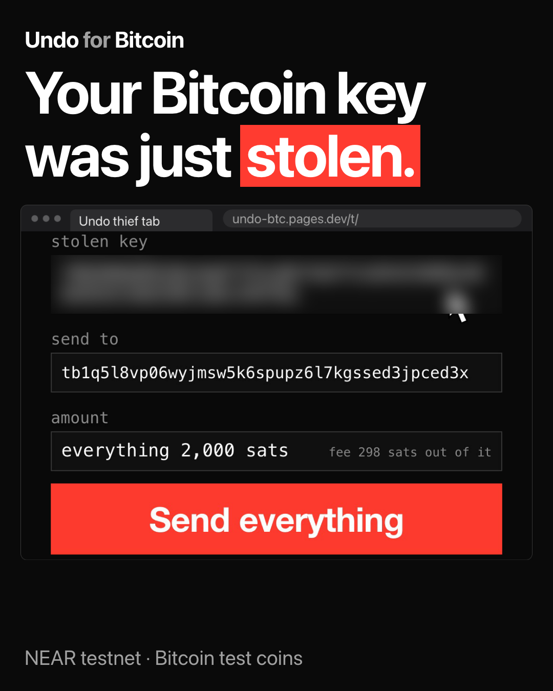

# Undo for Bitcoin

A cancel button for native Bitcoin, on test networks: Bitcoin itself refuses a stolen spend key alone, NEAR Chain Signatures gives the second signature when a public NEAR contract asks, and the contract asks only after a public wait that your phone's passkey can cancel. NEAR alone cannot take the coins; with no NEAR, a cold key gets them out after a Bitcoin timelock.

[](https://undo-btc.pages.dev/)

[The film](https://undo-btc.pages.dev/): about a minute, cut from one take on test networks: the phone page in Safari on the author's iPhone, from that iPhone's own screen recording, with Face ID, as the author reported it, and the thief tab in headless Chrome on a Mac, a second device. The drawn tiles after the cancel show the final build's run of 2026-11-11. The narration is a synthetic voice.

## Problem

A stolen Bitcoin spend key means stolen coins, at once and for good. Multisig stops that only if a second key signs every spend. Undo keeps one-key spending and adds a public wait and a cancel.

## How NEAR fits (tracks: open, security, defi)

Each claim number below is a row of [CLAIMS.md](CLAIMS.md), with its command, its date and the hash it rests on.

- **Chain Signatures.** NEAR's MPC signers (`v1.signer-prod.testnet`) hold the second key of each vault's Bitcoin script. The contract asks them to sign only after a request's public wait has run out (C01), and `./verify.sh A` fetches 22 recorded signing transactions again and verifies the signer's signatures in them here: 21 on an earlier build of the contract, 1 on the final build (C12).
- **A public contract as referee.** `v1.s.undo-btc.testnet` keeps the rules and the clock where anyone can read them, and checks the owner's passkey itself, on chain, as a WebAuthn P-256 assertion: a cancel needs no wallet and no NEAR account, a relay pays the gas, and one passkey call cancels the vault's whole queue (C05, C17). That ran with software passkeys and Chrome's virtual authenticator, on NEAR testnet with one request pending and on a local node with several; and twice from a real phone on the live pages, each a cancel from an iPhone in Safari, as the author reported it (no chain says which device held a passkey, and each assertion reads user verified, not how), and each checked again by `./verify.sh A`: 2026-11-12, an iPhone 13 Pro Max on iOS 27.2.1, with the thief tab a second Safari tab on the same phone, NEAR testnet tx `HHzwhu5f3GxY7B3Y8abdtuKJirZsHVAdRoyGG6UXBSE9`, in a block 20.6 s after the proposal's; and 2026-11-13, the take the film is cut from, with the thief tab in headless Chrome on a Mac, a second device, NEAR testnet tx `7KkMUMoEuuHNSzCkZEHN7NfYcjzqC9zprHtrN3FrKNnD`, in a block 28.8 s after the proposal's.
- **Function-call keys.** An agent can hold a vault's spend key and a NEAR function-call key for `propose_btc` and `execute` only. The agent here is a CLI with `--json` output for a model to call; a test script drove the recorded run, not a model. What it proposes waits in public like any spend; NEAR refuses that key for cancel, rotate and policy calls, and the contract refuses what the agent can sign for them (C14, NEAR testnet, 2026-11-11: `./verify.sh A` reads that run's twelve transactions again; [agent/README.md](agent/README.md)).
- **NEAR alone can refuse, not take.** The signature NEAR gives cannot spend without the spend key's (C02), and the cold key in the recovery file gets the coins out after a Bitcoin timelock with no NEAR call (C04, C18). All three ran on the final build with Mutinynet test coins, 2026-11-11.
- **Not used:** NEAR Intents, TEE attestation. A NEAR AI model signature checked on testnet is **not yet run** (C08).

Track hints this leans on: chain abstraction (open), function-call keys and agent security (security), Chain Signatures (defi).

## Not done yet

- A Cancel from a real phone has run twice, each from an iPhone in Safari, as the author reported it: with the thief tab as a second Safari tab on that iPhone, 2026-11-12, and with the thief tab in headless Chrome on a Mac, a second device, 2026-11-13, the take the film is cut from (C05). From any other phone, and from a laptop or desktop with its own passkey: **not yet run**.
- The lock: the deploy's full-access key is still on the test contract, so its holder could replace the code at once, and C11 fails in `./verify.sh A`.
- Mainnet: not deployed and not run (C19). Test networks only.
- An audit: the code is unaudited.
- A NEAR AI model signature for the guard's hold, checked on testnet: **not yet run** (C08).

## Run it

No key, no wallet, no browser: Node 20+ and Rust. Each command prints one line per check, and these are the last lines to expect.

| Run | Takes | Ends with |
|---|---|---|
| `./verify.sh A` | 1 to 3 min, most of it waiting on public RPCs; the first run also builds the referee in `tools/rust-check` | Expected today: `TIER A: 73 PASS, 0 SKIP, 1 FAIL, 3 INFO`, exit 1. The one FAIL is C11, which this entry reports about itself: the deploy's full-access key is still on the test contract, so its holder could replace the code without the 1 h public wait (see Operator below). The other lines read the deployed contract, fetch the real NEAR testnet and Mutinynet transactions in `proofs/` again, the final build's co-signed spend and cold-key escape among them, and re-verify their signatures here, fetch the live phone page's Cancel again and verify its passkey signature here, for the film's take and for the one-device run, both from a real phone (an iPhone, as the author reported it), and for the earlier film's take in headless Chrome, read the agent run's twelve transactions for who signed each and how it ended, and run a recovery-file dry run and a static check |
| `./demo.sh` | 1.5 to 3 min | `PASS demo-1` to `PASS demo-5`, then `DEMO PASS`. On the contract `deploy/testnet.json` names, through its relay: a throwaway vault with a software passkey, a proposal to a new address, a passkey cancel, and a send back to the vault's own address that the live signer signs after its 1:00 wait. No coin moves, but its NEAR calls are real NEAR testnet transactions, which the relay pays for |
| `./verify.sh B` | under 1 min once compiled; 1 to 2 on the first run, which compiles | `TIER B PASS`: the vault state machine and the Bitcoin consensus tests, offline |

**Reading the lines.** Each `./verify.sh` line is `PASS`, `SKIP` or `FAIL`, a claim number from [CLAIMS.md](CLAIMS.md), and a label for where it ran; only the lines that say a tool is missing, a whole suite failed, or the config cannot be read carry no claim number, and `INFO` lines are explained under Labels below. A `./demo.sh` line carries its step, `demo-1` to `demo-5`, where the claim number goes. `SKIP` means the check did not run, and the line says why. A second `./verify.sh A` within a few minutes can hit the archival RPC's rate limit, and those replay lines then print `SKIP (network)`. `./demo.sh` goes through the relay, whose daily limits are shared: if it is down or at its limit the run prints `SKIP demo (relay)` and points to `./verify.sh A` and `B`. `./verify.sh` with no letter runs A, then B. The dated runs of `./demo.sh`, with their transactions, are under Self-test in [CLAIMS.md](CLAIMS.md).

**Tests behind these.** Last full local run, 2026-11-07, with a mock signer in place of Chain Signatures ([docs/measurements.md](docs/measurements.md)): 151 sandbox tests passed on each of NEAR protocols 86 and 88, and mutation testing with hand-written one-rule mutants killed 187 of 187 in the core and 200 of 200 in the contract shell. They are not part of `./verify.sh`; see Build under More.

### See it on chain

Seven transactions of the final build (wasm `358c63bf…`, contract `v1.s.undo-btc.testnet`), 2026-11-11 to 2026-11-13, on NEAR testnet and Mutinynet, a Bitcoin signet with test coins. `./verify.sh A` fetches all seven again: the first three are in `proofs/g2-v1.json`, the fourth in `proofs/film-take.json`, the next two in `proofs/chrome-take.json`, the last in `proofs/phone-take.json`.

- The co-signed spend, mined on Mutinynet at height 3582225 with two signatures, the spend key's and the one Chain Signatures gave: [`8081f059b9539f6b2fc3d1930ae48ae100d2fa396f32f0c2f1ee03e0c60c60a2`](https://mutinynet.com/tx/8081f059b9539f6b2fc3d1930ae48ae100d2fa396f32f0c2f1ee03e0c60c60a2)
- The NEAR testnet transaction whose signer answer that spend carries: the contract's `execute`, 11 s after the request's 10:00 unlock, asking `v1.signer-prod.testnet` to sign. The test script's own NEAR account sent it, with no page and no relay: [`HpVWQDjf57nBxBLM4fVnDVZYZPggXmhjj1o7cD1yZiEh`](https://testnet.near.rocks/tx/HpVWQDjf57nBxBLM4fVnDVZYZPggXmhjj1o7cD1yZiEh)
- The cold-key escape, mined on Mutinynet at height 3582232, 6 blocks after its coin, with one signature, the cold key's from the recovery file, and no NEAR call: [`ca68df62ee9d7046e33112c0126169438c730f32c7f669ffa3149b2bfe7618f2`](https://mutinynet.com/tx/ca68df62ee9d7046e33112c0126169438c730f32c7f669ffa3149b2bfe7618f2)
- A passkey Cancel from a real phone with the thief tab on a second device, `cancel_all_and_rotate`, on the live pages, 2026-11-13, the take the film is cut from, another vault of the same contract, in a block 271 s before the thief's request would have unlocked. As the author reported it, the passkey was an iPhone's, in Safari, with Face ID, and the thief tab ran in headless Chrome on a Mac. No chain says which device held a passkey, and its assertion reads user verified, not how. The relay's NEAR account sent it; `./verify.sh A` verifies its WebAuthn signature again, under the passkey that vault was made with: [`7KkMUMoEuuHNSzCkZEHN7NfYcjzqC9zprHtrN3FrKNnD`](https://testnet.near.rocks/tx/7KkMUMoEuuHNSzCkZEHN7NfYcjzqC9zprHtrN3FrKNnD)
- A passkey Cancel from the live phone page, `cancel_all_and_rotate`, the earlier film's take (film v2), 2026-11-11, in a block 272 s before the thief's request would have unlocked. The passkey was Chrome's virtual authenticator, not a phone's, and the relay's NEAR account sent it; `./verify.sh A` verifies its WebAuthn signature again, under the passkey the vault was made with: [`HkxHDQDrs6tXuDqKfJNnjs6T4gAUvgGgnT4Dsc8RbpCL`](https://testnet.near.rocks/tx/HkxHDQDrs6tXuDqKfJNnjs6T4gAUvgGgnT4Dsc8RbpCL)
- An `execute` of that cancelled request, in a block 291 s after its 5:00 wait had run out. The contract refused it, `RequestNotFound`, and asked the signer for nothing; the vault's coin read unspent again on 2026-11-12: [`DPVhY5jWqiVjomPHmEgsDYEVqgSse1W8WcmaEabE1n5f`](https://testnet.near.rocks/tx/DPVhY5jWqiVjomPHmEgsDYEVqgSse1W8WcmaEabE1n5f)
- A passkey Cancel from a real phone, `cancel_all_and_rotate`, on the live pages, 2026-11-12, another vault of the same contract, in a block 279 s before the thief's request would have unlocked. As the author reported it, the passkey was an iPhone's, in Safari, and the thief tab was a second Safari tab on that iPhone; no chain says which device held a passkey, and its assertion reads user verified, not how. The relay's NEAR account sent it; `./verify.sh A` verifies its WebAuthn signature again, under the passkey that vault was made with: [`HHzwhu5f3GxY7B3Y8abdtuKJirZsHVAdRoyGG6UXBSE9`](https://testnet.near.rocks/tx/HHzwhu5f3GxY7B3Y8abdtuKJirZsHVAdRoyGG6UXBSE9)

## Try it

| Do | See |
|---|---|
| Open https://undo-btc.pages.dev | The film, about a minute, muted until you unmute it: a thief's send that Bitcoin refuses, the public wait on NEAR, the phone page's Cancel. Under it, that take's four hashes and three from the final build's run, each linked to an explorer |
| Press **Watch a recorded run** (`/replay/`) | Six steps from the final build's recorded runs, each with its real hashes from `proofs/`: the spend key alone refused by Bitcoin, a request made to wait 10:00, the phone page's Cancel (from the film's take, another vault of the same contract), the co-signed spend, the cold key's exit. Nothing on that page is live |
| Open `/p/` in a browser that has a passkey, then follow the four steps below | A test vault on the contract `deploy/testnet.json` names, a theft Bitcoin refuses in the thief tab `/t/`, a wait you can read on NEAR testnet, and your Cancel. From a real phone this ran twice, from an iPhone in Safari each time, as the author reported it: with both pages on that iPhone, 2026-11-12, and with the thief tab in headless Chrome on a Mac, 2026-11-13 (below) |

### Try a cancel yourself

You need a phone that can make passkeys, and a laptop; or one browser with a passkey and two tabs, on a phone, a laptop or a desktop (see "On one device" below). The relay pays the NEAR gas, and its daily limits are shared by everyone who tries this, `./demo.sh` runs included. So it can be full. [docs/relay.md](docs/relay.md) has the rest of the relay's accounting.

From a real phone this has run twice, on these live pages. First, 2026-11-12, on one device: one iPhone, with the phone page and the thief tab as two Safari tabs on it, as the author reported it (iPhone 13 Pro Max, iOS 27.2.1, Safari; see "On one device" below). What the chains show, which `./verify.sh A` reads again (`proofs/phone-take.json`, and the real phone in [CLAIMS.md](CLAIMS.md)): a vault made through the relay (NEAR testnet tx `3ek9TdcxB588YzswGM9YPgHgYBfrWHxD8K2jJs38j7B5`), a 2,000-sat test coin at its address, a send of that coin to a new address, proposed through the contract with a 5:00 wait (`9xgJmaGCaYVH5URhXUg27cXWu7StoGZSH72WRXvhsGFb`), and the phone page's Cancel, `cancel_all_and_rotate`, in a block 20.6 s after the proposal's (`HHzwhu5f3GxY7B3Y8abdtuKJirZsHVAdRoyGG6UXBSE9`), its passkey signature checked again here; the coin read unspent after the wait. Which device held the passkey, no chain says. Then, 2026-11-13, with the thief tab on a second device, the take the film is cut from: the phone page in Safari on an iPhone, with Face ID, as the author reported it, and the thief tab in headless Chrome on a Mac, opened from the thief link the phone page copied, its **Send everything** pressed by a script. The Mutinynet node refused the spend key alone, in its own words on the thief tab. What the chains show, which `./verify.sh A` reads again (`proofs/film-take.json`, and the film's take in [CLAIMS.md](CLAIMS.md)): a vault made through the relay (NEAR testnet tx `DvqsVvvVV4w67D83QRsKjiEba6hYyrx4w79smRMX8jHD`), a 2,000-sat test coin at its address, a send of that coin to a new address, proposed through the contract with a 5:00 wait (`CqtSuSE4uksdgzvikW54H4i8oPSGkkbVqYNiYWVcSJdP`), and the phone page's Cancel, `cancel_all_and_rotate`, in a block 271 s before that unlock (`7KkMUMoEuuHNSzCkZEHN7NfYcjzqC9zprHtrN3FrKNnD`), its passkey signature checked again here; the coin read unspent after the wait. Its assertion reads user verified, not how. It has also run from these live pages in headless Chrome, with Chrome's virtual authenticator in place of a phone's passkey, 2026-11-11: the vault, the test coin, the Mutinynet node's refusal of the spend key alone, the 5:00 wait, and the phone page's Cancel, which sends `cancel_all_and_rotate` (C05, C17, and the live take in [CLAIMS.md](CLAIMS.md)).

1. On the phone, open https://undo-btc.pages.dev/p/ in Safari or Chrome itself, not inside X or Telegram, and tap **Make a test vault**, then **Confirm with your passkey**: two passkey prompts. This makes a passkey for undo-btc.pages.dev and a vault on NEAR testnet.
2. Tap **Get test coins**, then **Copy the thief link**, and send that link to the laptop. It holds the vault's spend key, as a thief would. Copy it before you leave or reload the page: the page holds the spend key only while it is open. **Recovery file** downloads the cold key, which the page also holds only while it is open; after a Cancel that key is the only way to move this vault's coins.
3. On the laptop, open the link (the thief tab, `/t/`). **send to** is filled in with a fresh test address that nobody holds. You can type any other `tb1` address, but not the vault's own: the contract treats a send there as the owner's own, which waits only 1:00. Press **Send everything**. Bitcoin refuses the spend key alone. The tab then proposes the same send through the contract, which makes it wait in public: 5:00 if you send within 20 minutes of making the vault, 10:00 after that (see Guard below).
4. On the phone, tap **Cancel** before the wait ends.

**On one device.** One browser with a passkey is enough, on a phone, a laptop or a desktop: do steps 1 and 2 in one tab, paste the thief link into a second tab of the same browser, press **Send everything** there, and switch back to the first tab to **Cancel**. Keep the first tab open throughout. It ran this way from a real phone, 2026-11-12: one iPhone, with the two pages as two Safari tabs, as the author reported it; the Cancel is NEAR testnet tx `HHzwhu5f3GxY7B3Y8abdtuKJirZsHVAdRoyGG6UXBSE9`, and no chain says which device held its passkey. It also ran in one headless Chrome with two windows and Chrome's virtual authenticator, 2026-11-11 (NEAR testnet tx `GAMM2dVDA7aqiqer2utr1LXoYZEm9ccM8vbHYzZpovPk`, the Cancel). From a laptop or desktop with its own passkey it has **not yet run**.

## Who can do what, and what happens if each is gone

| Party | Alone it can | Alone it cannot | If it is gone |
|---|---|---|---|
| Owner's phone (passkey, P-256, checked by the contract) | Cancel any pending spend at once. Cancel every one and swap the NEAR-side spend key (`K_s`); `K_u` stays in the vault's Bitcoin script, so move the coins to a new vault afterwards. On a vault the page made, that means the cold key: the page's Cancel swaps in a `K_s` whose secret it does not keep, so save the recovery file first. In the contract it can also tighten the rules at once (on this test instance only the fee and outflow caps, since the waits are at their maximum); loosening them waits `T_new`, and the cold key can veto it. Of these, the phone page signs only its Cancel (`cancel_all_and_rotate`) | Move a coin: it holds no Bitcoin key | Spending still works; only the phone's cancel is gone (the cold key can still cancel). The contract lets the cold key start passkey recovery, but no page or tool here does that yet |
| Spend key (one seed: a NEAR-side signing key and the Bitcoin key `K_u`) | Propose a spend. Every proposal waits in public: on this test vault 60 s to a known address, and 5 min to a new one while the guard's heartbeat is fresh, 10 min when it is not (the relay beats only when it makes the vault, so after 20 minutes it is not), set per vault. If nobody cancels, the contract co-signs once the wait ends, so the coins go. Hold back co-signed sends to the vault's own address, which can delay the cold key's exit (see Cold key) | Move a coin before its wait ends, or after the owner cancels: Bitcoin also needs the contract's signature, which comes only after the public wait. Cancel, shorten a wait, change the rules | Coins leave through the cold key after the timelock |
| Agent key (an agent holding a vault's spend key, plus a NEAR function-call key for gas) | What the spend key can: propose, and pay for `execute` | Cancel, swap keys, shorten a wait, attach a deposit | Nothing locks: the phone path needs no agent |
| NEAR contract (public, on NEAR testnet) | Keep the rules and the clock. After the wait, ask Chain Signatures for Bitcoin's second signature. Refuse or stall | Spend: Bitcoin also needs the spend key's signature | The cold key gets the coins out after the timelock |
| Chain Signatures network (NEAR's MPC signers) | Sign what the contract asks. Refuse or stall. Colluding with a thief who has the spend key, skip the wait | Spend: Bitcoin also needs the spend key's signature | The cold key gets the coins out after the timelock |
| Cold key (the recovery file; offline once you have saved it and closed the page) | Move any coin older than the timelock (6 blocks on this test vault) with no NEAR at all. Freeze the vault, cancel, veto a change the passkey started (a loosening, a new destination or guard, or the new `K_s`). The contract also lets it start passkey recovery, but no page or tool here does that yet | Propose. Move a coin younger than the timelock. Get ahead of co-signed sends to the vault's own address that the spend key held back: each one restarts the timelock when it is broadcast, up to 31 a day on test coins, and the escape must outbid them on fee | Nothing breaks now. Move the coins to a new vault. If it is stolen, aged coins are lost: keep it offline |
| Guard (the relay's NEAR account, which each vault the page makes names) | Keep a new-destination wait at 5:00 by its heartbeat; a beat older than 20 minutes reads offline, and that wait is then 10:00. The relay beats once, when it makes the vault, so on a vault the page makes a new destination waits 5:00 for 20 minutes and 10:00 after. Put one 5-minute hold on a pending request, only with a model signature from a signer the operator registered: `new` registers none | Make any wait shorter than the vault's rules set with the guard online, cancel, spend | New-destination waits are 10:00; nothing else changes |
| Operator (deploys the contract, runs the relay and the page) | Propose new contract code, which waits in public longer than any withdrawal (1 h on this test instance); nothing alerts you to a pending upgrade, so watch `status`. Register a model signer and set the guard model at once, which can only delay. Withhold or delay relayed calls. A changed page could lie, or take the spend key and the cold key: the test page makes both in one tab and holds them while it is open | Change code sooner, once the deploy's full-access key is gone (C11 checks; the instance `deploy/testnet.json` names today still has that key, so C11 fails on it), spend, or forge your cancel | The contract keeps running; any NEAR account can send the same calls. Passkeys only work from undo-btc.pages.dev: without that page the phone cannot cancel, and the cold key cancels, freezes and exits |

**Why not 2-of-3?** If one key is stolen and nobody is watching, 2-of-3 is safer: that thief gets nothing, and Undo's thief gets the coins after the wait. Undo makes a different trade. Spending needs no second device or hardware, so it can be used for everyday spending; a public contract controls the second signature, not a company; a phone can cancel during the wait; a cold key leaves alone if NEAR is gone. If you can keep two keys in reach for every spend, use 2-of-3.

**The relay is a convenience.** The phone page sends its cancel through a relay that pays the gas. Its daily limits are shared by everyone who uses it, so it can be full or down when you need it. The contract takes the same passkey-signed cancel from any NEAR testnet account: `tools/cancel.mjs` sends one the phone page signed. The cold key in the recovery file needs no relay and, for its exit, no NEAR: it moves a coin only once the coin is older than the timelock. The relay's limits are in [docs/relay.md](docs/relay.md).

**Privacy.** The queue is public: anyone can read each vault's pending amounts and destinations, its cancels and their timing, before Bitcoin moves. Vault ids are hashes, not names. This version claims no privacy.

**5:00 is the test preset.** The waits here, 1:00 to an address the vault knows, 5:00 to a new one and 10:00 with the guard offline, are the test-coin preset's. The contract's mainnet preset is in the code, not deployed and not run (C19): there a send to a new address waits at least 10 minutes, 20 with the guard offline, and a vault can set those as long as 24 and 48 hours. A cancel that lands after the wait can be too late, so the wait is the time the owner has to notice and act. The outflow cap is not a loss limit: over it a known address waits like a new one, nothing is refused, and a send to a new address is never capped.

**Test networks only.** NEAR testnet and Mutinynet test coins, addresses starting `tb1`. Nothing here runs on NEAR mainnet or holds real bitcoin. The code is unaudited.

**Labels** on every `verify.sh` and `demo.sh` line: `[live-testnet]` NEAR testnet, `[live-mutinynet]` Mutinynet (a Bitcoin signet), `[replay]` a real hash fetched again, `[consensus-lib]` libbitcoinconsensus, `[regtest]` a local bitcoind, `[unit]` pure Rust with no chain, `[static]` a read of the source, `[mock-signer]` a local NEAR node with a mock signer. `INFO` lines are totals, or a record read from `proofs/` and not checked again. The terms (`K_u`, `K_s`, `K_m`, `K_e`, `T_known`, `T_new`, guard, hold, CSV, G1, G2) are explained under Terms in [CLAIMS.md](CLAIMS.md).

## What was built in the window

This repository started on 2026-10-31, inside the hackathon window (from 2026-10-19), and all code in it was written in the window, except the vendored libraries listed under More (`tools/vendor/noble`). Labels say how far each part has run; [CLAIMS.md](CLAIMS.md) has the commands, dates and hashes.

| Part | What | Ran |
|---|---|---|
| `crates/undo-core` | The vault state machine: waits, cancel, rotation, fee budget, recovery, upgrades | `[unit]` with property tests |
| `crates/undo-btc` | The two-branch Bitcoin script, BIP-143 signing, the recovery file and its dry-run escape | `[consensus-lib]`, `[regtest]` |
| `contracts/undo` | The NEAR contract | `[mock-signer]`. An earlier build ran on NEAR testnet with the real signer and Mutinynet coins: `[live-testnet]`, `[live-mutinynet]`, in `proofs/`. The final build `358c63bf…` runs on NEAR testnet as `v1.s.undo-btc.testnet`, and `./demo.sh` ran on it with the real signer, 2026-11-10 `[live-testnet]`. With Mutinynet test coins it ran the pages' live take and the agent run, 2026-11-11 `[live-testnet]` `[live-mutinynet]`: vaults, proposals, passkey cancels and rotations, and the Mutinynet node's refusal of the spend key alone, with no request executed. A co-signed spend of a Mutinynet coin and a cold-key escape ran on the final build, 2026-11-11 `[live-testnet]` `[live-mutinynet]`, in `proofs/g2-v1.json`: a proposal waited its 10:00 in public, the live signer signed, and the spend was mined with both signatures (Mutinynet txid `8081f059b9539f6b2fc3d1930ae48ae100d2fa396f32f0c2f1ee03e0c60c60a2`, height 3582225); the escape, built from the recovery file alone with no NEAR call, was refused while its coin was young and mined 6 blocks after it (`ca68df62ee9d7046e33112c0126169438c730f32c7f669ffa3149b2bfe7618f2`, height 3582232); and the Mutinynet node refused the spend without the spend key's signature, a copy of the escape signed for one block less than the timelock, and the spend key alone. `./verify.sh A` fetches the two mined transactions again and judges the refused ones again (a co-signed spend and an escape also ran on the earlier build, in `proofs/g2.json`) |
| `tools/` | Gate drivers, the offline escape and freeze tools, the referee in `tools/rust-check`, the phone-alert watcher `tools/watch.mjs` | `[regtest]`, `[live-testnet]`, `[live-mutinynet]`; the watcher `[mock-signer]`, and a read-only dry run on NEAR testnet |
| `agent/` | The agent CLI: `undo propose`, `check`, `status`, `keys`, with a function-call key that cannot cancel | `[mock-signer]`; on NEAR testnet against `v1.s.undo-btc.testnet`, the final build, with a Mutinynet test coin, 2026-11-11 `[live-testnet]` `[live-mutinynet]` (C14). The owner's passkey there was a software authenticator, and no request was executed |
| `site/` | The pages and the relay | `[mock-signer]` on a local stage. The live relay, as deployed on 2026-11-10, served `./demo.sh` on NEAR testnet against the final build `[live-testnet]`. The live phone page and thief tab ran a theft and its cancel end to end in headless Chrome, with Chrome's virtual authenticator in place of a phone's passkey, 2026-11-11 `[live-testnet]` `[live-mutinynet]`; from a real phone, twice: a vault, a request through the contract and the phone page's Cancel before its unlock, from an iPhone in Safari each time, as the author reported it, with the thief tab a second Safari tab on it, 2026-11-12, in `proofs/phone-take.json`, and with the thief tab in headless Chrome on a Mac, 2026-11-13, the take the film is cut from, in `proofs/film-take.json` `[live-testnet]` `[live-mutinynet]` |
| `verify.sh`, `demo.sh`, `CLAIMS.md` | The judge's path | `demo.sh` on a local stage `[mock-signer]`, on the final build; on NEAR testnet against `v1.s.undo-btc.testnet`, the final build, 2026-11-10 `[live-testnet]`; `./verify.sh A` against it the same day, 37 PASS and the one FAIL, C11; 2026-11-11, with the agent run's lines, 49 PASS and the same FAIL; later that day, with the lines for the final build's co-signed spend and escape, 60 PASS and the same FAIL; 2026-11-12, with the lines for the live phone page's Cancel, 65 PASS and the same FAIL; later that day, with the lines for the Cancel from a real phone (an iPhone, as the author reported it), 69 PASS and the same FAIL; 2026-11-13, with the lines for the film's take, from a real phone with the thief tab on a second device (an iPhone, as the author reported it), 73 PASS and the same FAIL |

Git tag `hackathon-submission` marks the judged commit once it exists.

## More

- Status with no server: the contract's `status` view over public RPC, printed as the contract's JSON, whose `lines` say it in plain language. `<CONTRACT>` is `contract` in `deploy/testnet.json`. If the RPC refuses, the line prints its error instead:
  ```
  curl -s https://test.rpc.fastnear.com -H 'content-type: application/json' -d '{"jsonrpc":"2.0","id":"u","method":"query","params":{"request_type":"call_function","finality":"final","account_id":"<CONTRACT>","method_name":"status","args_base64":"e30="}}' | python3 -c 'import sys,json;r=json.load(sys.stdin);x=r.get("result") or {};print(bytes(x["result"]).decode() if "result" in x else "RPC refused: "+json.dumps(r.get("error") or x.get("error")))'
  ```
- Build: `scripts/build.sh`. It needs Rust with the `wasm32-unknown-unknown` target (`rustup target add wasm32-unknown-unknown`) and binaryen's `wasm-opt`. The hashes in CLAIMS.md came from rustc 1.98.1 and `wasm-opt` version 133; other versions may give other bytes, and the script prints whether its output is the wasm `deploy/testnet.json` records. To rebuild with that rustc: `rustup toolchain install 1.98.1 --target wasm32-unknown-unknown`, then `RUSTUP_TOOLCHAIN=1.98.1 scripts/build.sh`, with `wasm-opt` 133 on the path. A plain `cargo build -p undo-vault --target wasm32-unknown-unknown` stops on purpose, because it would lose `--cfg near` and the path remapping; at the root a plain `cargo build` makes only the two library crates and no contract wasm. Sandbox suite: `scripts/protocol-check.sh`, after a build: protocols 86 and 88 by default, about 35 minutes each here, with long silent stretches; its first line, wasm-opt's `no passes specified` warning, is expected. It needs `NEAR_SANDBOX_BIN_PATH`, the near-sandbox binary, release 2.14.0 here (protocol 88), from `https://s3-us-west-1.amazonaws.com/build.nearprotocol.com/nearcore/<Darwin-arm64 or Linux-x86_64>/2.14.0/near-sandbox.tar.gz`; a macOS build of it may also need `UNDO_LIBLZMA_DIR`, a folder holding `liblzma.5.dylib`. `scripts/setup-repo.sh` is for the author's clone only. `tests/REGRESSION-MAP.md` maps each attack-review finding to its test; `docs/measurements.md` has gas and size.
- The agent on a local node: `agent/test/run-sandbox.sh 86 88` (a local NEAR sandbox node, see Build above) shows the agent CLI ([agent/README.md](agent/README.md)) proposing with a NEAR function-call key, then NEAR refusing that key for `cancel`, `cancel_all_and_rotate`, `set_policy`, `clear_hold` and `add_destination` in its own words (`MethodNameMismatch`), and the contract refusing what the agent can sign for them. Ends `AGENT SANDBOX OK: 86 88 [mock-signer]`. The same ran once on NEAR testnet, 2026-11-11 `[live-testnet]`, on `v1.s.undo-btc.testnet` with a Mutinynet test coin and a software passkey as the owner's: the record is `proofs/c14-agent.json`, and `./verify.sh A` fetches its twelve transactions again (C14).
- Phone alerts: `tools/watch.mjs` watches one vault over public RPC and pushes one ntfy alert for each new request, however it was proposed. It does not watch the contract for upgrades. [docs/watch.md](docs/watch.md) says what ntfy.sh and the phone's push service can see. Run on a local sandbox `[mock-signer]`; on a phone: **not yet run**.
- Baseline: the delay-and-cancel idea follows the author's earlier project Eleven Seconds (github.com/tedinroc/eleven-seconds, MIT), an upgrade cooling period in Solidity: design only, no code copied.
- Name: another entry in this hackathon is also named Undo. It is a different project by a different team.
- Libraries: near-sdk, rust-bitcoin with libbitcoinconsensus (tests and tools), k256, p256, sha2, sha3, borsh, hex, bs58, serde and serde_json, proptest, near-workspaces with tokio, anyhow, near-gas, near-token and ed25519-dalek (sandbox tests), hkdf (`tools/rust-check`), and in Node `@noble/curves` 1.9.7 and `@noble/hashes` 1.8.0, vendored in `tools/vendor/noble`.

## Credits and license

Built by Ted Chen with AI coding assistance (Claude). The film's narration is a synthetic voice (AI text-to-speech), not a recording of a person. MIT, see [LICENSE](LICENSE).
